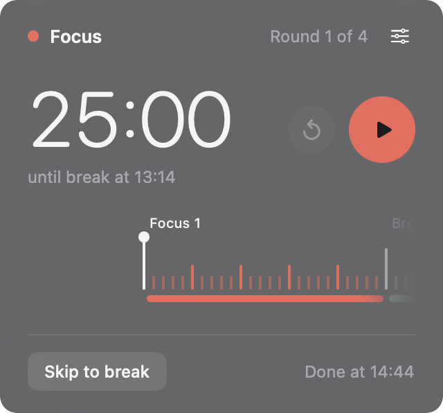

# Tape

A calm Pomodoro timer for the Mac menu bar: your session is a tape of minutes sliding past a needle.



- The menu bar shows a small coloured strip of the whole session and the time left in the current block.
- Click it for the panel: the countdown, Start/Pause, Restart, Skip, and the tape.
- By default a session is four rounds of 25 minutes focus and 5 minutes break, and each block runs straight into the next.
- Settings (the sliders button in the panel) change the focus and break lengths, the number of rounds, and add a long break every few rounds. A live preview shows the whole session and how long it takes. You can also turn off auto-continue and hide the countdown in the menu bar.
- Time is worked out from the clock, so it stays right through sleep and pauses.
- Tape lives only in the menu bar. It has no Dock icon and no window. To quit, use **Quit Tape** at the bottom of Settings, or press ⌘Q while the panel is open.

## Requirements

- macOS 13 Ventura or later
- A Mac with Apple silicon (M1 or later)

## Install

1. Download `Tape-<version>.dmg` from the [Releases page](https://github.com/sasiiiiindu/Tape/releases).
2. Open the DMG and drag **Tape** onto **Applications**.
3. Open Tape from your Applications folder. It appears in the menu bar.

### Opening Tape the first time

Tape is free and isn't signed with a paid Apple Developer ID, so macOS blocks it the first time you open it. You only need to allow it once.

**macOS 15 Sequoia and later**

1. Open Tape. macOS says it can't verify the app. Click **Done**.
2. Open **System Settings > Privacy & Security**.
3. Scroll down to **Security**. Next to the message that Tape was blocked, click **Open Anyway**.
4. Enter your password (or use Touch ID), then click **Open Anyway** again.

**macOS 13 Ventura and 14 Sonoma**

Control-click Tape in Applications, choose **Open**, then click **Open**. The Sequoia steps above work too.

**Or, in Terminal (any version)**

```sh
xattr -dr com.apple.quarantine /Applications/Tape.app
```

This removes the "downloaded from the internet" mark that makes macOS block the app. After that, Tape opens normally.

To check your download, compare its SHA-256 with the one on the release page:

```sh
shasum -a 256 ~/Downloads/Tape-<version>.dmg
```

## Build from source

You need Apple's Command Line Tools (`xcode-select --install`). Full Xcode is not needed.

```sh
git clone https://github.com/sasiiiiindu/Tape.git
cd Tape
./scripts/run.sh          # build and open the app
swift test                # run the tests
```

To make a release build and a DMG:

```sh
./scripts/build-app.sh    # -> dist/Tape.app
./scripts/make-dmg.sh     # -> dist/Tape-<version>.dmg, prints its SHA-256
```

The version number comes from the `VERSION` file.

## Licence

MIT. See [LICENSE](LICENSE).
