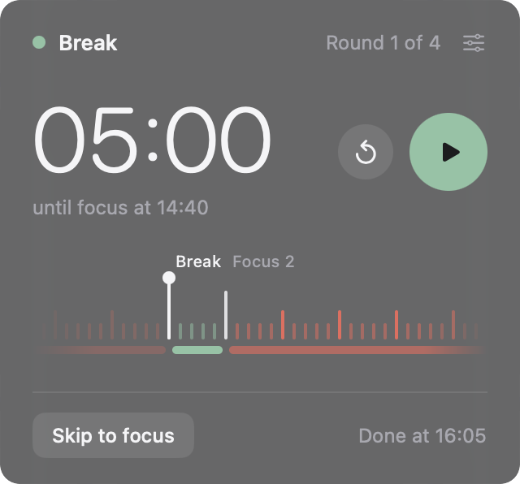
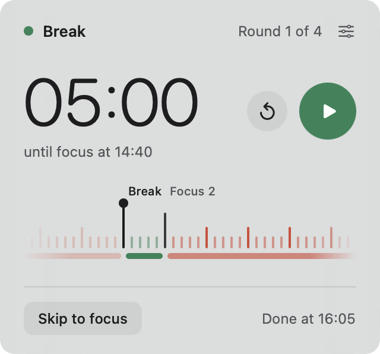

# Tape

A calm Pomodoro timer for the Mac menu bar: your session is a tape of minutes sliding past a needle.

<p align="center">
  
  
</p>

## Features

- **The tape.** Your whole session as a strip of minute ticks sliding past a fixed needle: focus in coral, breaks in green, long breaks in a deeper green.
- **Menu bar at a glance.** A small coloured strip of the session and the time left in the current block. The countdown can be hidden.
- **Controls.** Start, Pause, Restart the block, Skip to the next one. With the panel open, Space starts and pauses, S skips and Esc closes it.
- **Your own rhythm.** Focus 5–90 min, breaks 1–30 min, 1–8 rounds, and an optional long break every 2, 3 or 4 rounds. A live preview shows the whole session and how long it takes. The default is four rounds of 25 minutes focus and 5 minutes break.
- **Clock times.** "until break at 7:50 PM" and "Done at 8:50 PM", kept up to date as you pause.
- **When a block ends.** A chime (Soft chime, Bell or None) and a notification saying what's next. Each block can run straight into the next, or wait for you.
- **Picks up where you left off.** Quit Tape or restart your Mac mid-session and it comes back paused where it was.
- **Accurate.** Time is worked out from the clock, so it stays right through sleep, pauses and changes to the Mac's clock.
- **Fits in.** Light and dark mode, Reduce Motion, VoiceOver, launch at login, and an optional ⌃⌥T shortcut to open the panel from any app.
- **Out of the way.** Tape lives only in the menu bar, with no Dock icon or window. To quit, use **Quit Tape** at the bottom of Settings, or press ⌘Q while the panel is open.

## Requirements

- macOS 13 Ventura or later
- A Mac with Apple silicon or an Intel processor

## Install

1. Download `Tape-<version>.dmg` from the [Releases page](https://github.com/sasiiiiindu/Tape/releases).
2. Open the DMG and drag **Tape** onto **Applications**.
3. Open Tape from your Applications folder. It appears in the menu bar.

### Opening Tape the first time

Tape is free and isn't signed with a paid Apple Developer ID, so macOS blocks it the first time you open it. You only need to allow it once.

**macOS 15 Sequoia and later**

1. Open Tape. macOS says it can't verify the app. Click **Done**.
2. Open **System Settings > Privacy & Security**.
3. Scroll down to **Security**. Next to the message that Tape was blocked, click **Open Anyway**.
4. Enter your password (or use Touch ID), then click **Open Anyway** again.

**macOS 13 Ventura and 14 Sonoma**

Control-click Tape in Applications, choose **Open**, then click **Open**. The Sequoia steps above work too.

**Or, in Terminal (any version)**

```sh
xattr -dr com.apple.quarantine /Applications/Tape.app
```

This removes the "downloaded from the internet" mark that makes macOS block the app. After that, Tape opens normally.

To check your download, compare its SHA-256 with the one on the release page:

```sh
shasum -a 256 ~/Downloads/Tape-<version>.dmg
```

## Build from source

You need Apple's Command Line Tools (`xcode-select --install`). Full Xcode is not needed.

```sh
git clone https://github.com/sasiiiiindu/Tape.git
cd Tape
./scripts/run.sh          # build and open the app
swift test                # run the tests
```

To make a release build and a DMG:

```sh
./scripts/build-app.sh    # -> dist/Tape.app (Apple silicon + Intel)
./scripts/make-dmg.sh     # -> dist/Tape-<version>.dmg, prints its SHA-256
```

The version number comes from the `VERSION` file. If the Intel half of the build fails, `build-app.sh` says so and builds for Apple silicon only.

The app icon is made from `art/icon-1024.png` (a square PNG, at least 1024 px, with a transparent background):

```sh
./scripts/make-icon.sh    # -> Resources/AppIcon.icns
```

## Licence

MIT. See [LICENSE](LICENSE).
